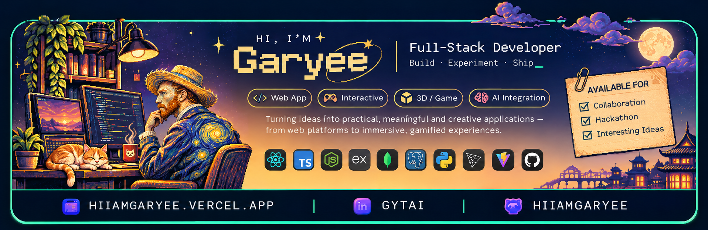

  

  
  
  

### `01 / THE PERSON BEHIND THE CODE`

Hey, I'm **Garyee** — a full-stack software engineer who enjoys transforming ambitious ideas into working, user-focused products.

My work spans **frontend interfaces, backend APIs, databases, game-like experiences, and AI-assisted workflows**. I care about what happens after a prototype looks good: data flow, usability, edge cases, and whether the whole thing actually works.

- **Engineering focus:** React, TypeScript, Node.js, Express, API integration, and MongoDB.
- **What I like building:** Real-world applications, interactive experiences, developer tools, and unusual product ideas.
- **How I work:** Prototype quickly, validate assumptions, refine the details, and keep shipping.
- **Current mindset:** Strong engineering should feel effortless to the people using it.

---

### `02 / TECHNOLOGY STACK`

| Area | Technologies |
| :--- | :--- |
| Programming | <a href="https://developer.mozilla.org/en-US/docs/Web/JavaScript"> JavaScript</a> · <a href="https://www.typescriptlang.org/docs/"> TypeScript</a> · <a href="https://docs.python.org/3/"> Python</a> · SQL |
| Backend & APIs | <a href="https://nodejs.org/docs/latest/api/"> Node.js</a> · <a href="https://expressjs.com/"> Express</a> · REST APIs |
| Data | <a href="https://www.mongodb.com/docs/"> MongoDB</a> · <a href="https://www.postgresql.org/docs/"> PostgreSQL</a> |
| Web & UI | <a href="https://react.dev/"> React</a> · <a href="https://tailwindcss.com/docs"> Tailwind CSS</a> · <a href="https://vite.dev/guide/"> Vite</a> |
| Tools & Deployment | <a href="https://git-scm.com/doc"> Git</a> · <a href="https://docs.github.com/"> GitHub</a> · <a href="https://docs.docker.com/"> Docker</a> · <a href="https://help.figma.com/"> Figma</a> |

---

### `03 / QUESTS COMPLETED`

A few projects and explorations that reflect what I like working on. Some are still evolving, and not all have public source repositories.

<table>
  <tr>
    <td width="50%" valign="top">
      01 / POST-APOCALYPTIC FICTION
      <h3>Armageddon</h3>
      
A post-apocalyptic short story and character blog platform. Explore immersive survival narratives, detailed character profiles, world-building lore, and serialized chapters set in a collapsing world where trust, betrayal, and survival shape every decision.

      
<code>React</code> <code>Tailwind CSS</code>

      
<a href="https://hiiamgaryee.vercel.app/hackathon/ampwise">View the project on my portfolio</a>

    </td>
    <td width="50%" valign="top">
      02 / 3D INTERACTIVE EXPERIENCE
      <h3>mati-app</h3>
      
A virtual memorial world with walkable 3D environments, personal memorials, interactions, and offerings.

      
<code>React</code> <code>TypeScript</code> <code>Three.js</code> <code>Express</code>

    </td>
  </tr>
  <tr>
    <td width="50%" valign="top">
      03 / HEALTH & PRODUCT DESIGN
      <h3>No Fat No Fat</h3>
      
A health-focused application concept exploring approachable interfaces, progress tracking, and everyday wellness workflows.

      
<code>Product UI</code> <code>Full Stack</code> <code>Health Tech</code>

    </td>
    <td width="50%" valign="top">
      04 / GAMIFIED RELATIONSHIPS
      <h3>Big Meow Little Pup</h3>
      
A couple-focused application concept that turns shared activities, mini-games, and experiences into playful interactions.

      
<code>React</code> <code>TypeScript</code> <code>Express</code> <code>MongoDB</code>

    </td>
  </tr>
</table>

  
  
  

---

### `04 / ACHIEVEMENT UNLOCKED`

  <a href="https://hiiamgaryee.vercel.app/"><strong>View My Hackathon Wins & Projects</strong></a>
   
  Explore the full list and results on my portfolio.

---

### `05 / SIDE QUESTS`

When I’m away from the keyboard, I’m usually skateboarding, climbing, hiking, playing guitar, or gaming. Basically, I collect side quests in and out of the pixel world.

---

### `06 / PARTY UP`

Have an interesting idea or want to build something together? [Explore my portfolio](https://hiiamgaryee.vercel.app/) or [reach out on GitHub](https://github.com/HiIamGaryee).

---

### `07 / HOW I APPROACH SOFTWARE`

| THINK | BUILD | IMPROVE |
| :--- | :--- | :--- |
| Start with the user and the actual problem. | Connect the UI, business logic, APIs, and data. | Test edge cases, simplify flows, and polish the experience. |

> Great software isn't just a polished screen. It's all the invisible pieces working together.

---

### `08 / GITHUB ACTIVITY`

  

Activity visualization is provided by a third-party service and may occasionally be unavailable. Visit my GitHub profile for the official contribution history.

---

  Designed with intention · Built by <strong>Garyee</strong>

